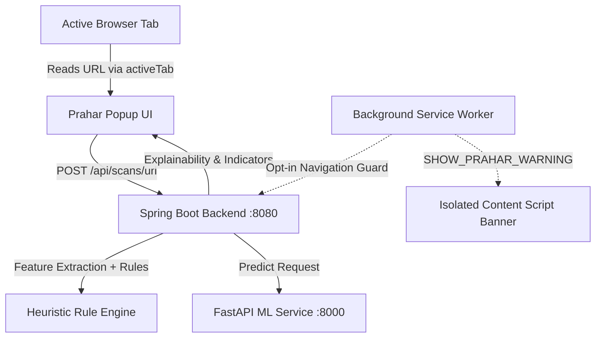

# Prahar Phishing & Web Shield — Chromium Browser Extension (v2.0.0)

**Prahar Phishing & Web Shield** is a cybersecurity browser extension built on **Google Chrome Manifest V3**. It connects directly to the Prahar Spring Boot backend (`http://localhost:8080`) to perform real-time URL risk assessment, heuristic threat detection, ML-driven explainability, and optional pre-navigation protection.

---

## Architecture & Design Principles



### Key Security & Privacy Commitments
1. **Permission Minimization**: Only requests `activeTab` and `storage`. Does not request intrusive permissions such as `<all_urls>`, `tabs`, or `cookies`.
2. **Privacy by Default**: Navigation protection is **disabled by default**. Prahar will never silently upload visited URLs or log browsing history. Real-time scanning only activates if the user explicitly turns it on in Settings.
3. **Zero Secrets in Extension**: All ML and Gemini AI API credentials remain exclusively stored on the Spring Boot backend server. No credentials or secret keys are stored in extension files.
4. **Zero Fabrication Policy**: If the Prahar backend is unreachable or offline, the extension displays an honest connection status. It will never fabricate fake risk scores, threat categories, or synthetic indicators.
5. **SSRF & Loopback Protection**: Internal browser pages (`chrome://`, `edge://`, `about:`, `file:`) and private IP ranges (`127.0.0.1`, `localhost`, `10.*`, `192.168.*`) are filtered and never dispatched to external scanning proxies.

---

## File Structure

```
browser-extension/
├── manifest.json       # Manifest V3 extension configuration & permission bounds
├── popup.html          # Responsive Prahar dark-themed interface
├── popup.css           # Vanilla CSS styling with glassmorphism and color-coded risk gauges
├── popup.js            # User-initiated tab inspector, manual scanner, and API client
├── background.js       # Service worker with TTL cache and opt-in navigation guard
├── content.js          # In-page threat alert banner rendered via Shadow DOM
├── test_extension.js   # Automated Node.js validation test suite
├── icons/              # Extension launcher and badge icons (16px, 48px, 128px)
└── README.md           # Documentation, installation guide, and test protocol
```

---

## Installation Guide (Chrome / Edge / Brave / Chromium)

1. Open your Chromium-based browser and navigate to:
   ```
   chrome://extensions
   ```
   *(For Microsoft Edge, navigate to `edge://extensions`)*
2. In the top right corner, toggle **Developer mode** to **ON**.
3. In the top left toolbar, click the **Load unpacked** button.
4. Browse to your repository folder and select the directory:
   ```
   MINI PRO SIH/browser-extension
   ```
5. The extension will appear with the title **Prahar Phishing & Web Shield** (Version 2.0.0).
6. Click the extension puzzle icon in your browser toolbar and click the **Pin** icon to keep Prahar visible.

---

## Configuration & Backend Connection

By default, the extension targets the local Prahar Spring Boot backend:
```
http://localhost:8080
```

To configure settings:
1. Click the **Prahar** shield icon in your browser toolbar to open the popup.
2. Click the gear **Settings** icon in the header.
3. Update fields as needed:
   - **Prahar Backend URL**: Set custom server URL (e.g., `http://localhost:8080` or production URL).
   - **JWT Auth Token (Optional)**: If you are logged into Prahar, paste your JWT token here to synchronize scans directly with your personal scan history on the web dashboard.
   - **Real-time Navigation Guard**: Check this box if you wish Prahar to automatically inspect visited domains in the background. *(Data notice: Visited domain hostnames will be queried against your configured Prahar backend).*
4. Click **Save Settings**.

---

## How to Test

### 1. Automated Validation Suite
Run the test suite using Node.js:
```bash
cd browser-extension
node test_extension.js
```
Expected output:
```
========================================
TEST SUMMARY: 10/10 Passed (100%)
========================================
```

### 2. Testing Internal / System Pages (Unsupported Scheme Guard)
1. Open a system page such as `chrome://extensions` or `chrome://settings`.
2. Open the Prahar extension popup.
3. Verify:
   - Status badge displays `SYSTEM`.
   - Card reads: `Browser Internal Page`.
   - "Scan This Page" button is disabled with an explanatory notice: *"Internal browser pages cannot be scanned and pose no phishing threat."*

### 3. Testing Legitimate / Safe Web Pages
1. Navigate to a known safe website, such as `https://github.com` or `https://wikipedia.org`.
2. Open the Prahar extension popup.
3. Click **Scan This Page**.
4. Verify:
   - Spinner activates during scanning.
   - Verdict displays green badge: `LEGITIMATE / SAFE`.
   - Risk score reflects a low score (e.g., 0–15 / 100).
   - Engine attribution displays the active engine (e.g. `AI/ML: Logistic Regression v1.0.0` or `Heuristic Rule Engine`).

### 4. Testing Phishing Indicators via Controlled Test Fixture
> **CAUTION**: Do not test on live malware or malicious domains. Test exclusively using safe, benign test URLs or the manual URL checker with known lexical fixtures:
1. In the extension popup, scroll to **CHECK ANOTHER LINK**.
2. Enter a controlled test fixture designed to trigger rule heuristics:
   ```
   https://secure-hdfc-kyc-verification-update.xyz/login
   ```
3. Click **Check**.
4. Verify:
   - Score gauge animates to `HIGH RISK PHISHING` (e.g., 85+ / 100).
   - Threat category displays `CREDENTIAL HARVESTING`.
   - Risk indicators list flags:
     - Suspicious TLD (`.xyz`)
     - High lexical keyword density (`secure`, `kyc`, `verification`, `login`)
     - Brand impersonation heuristics.
   - Recommended Action advises: *"Do not enter sensitive data or credentials on this site."*

### 5. Testing Backend Offline State (Zero Fabrication Verification)
1. If the Spring Boot backend is temporarily stopped, open the popup and click **Scan This Page**.
2. Verify:
   - Status dot turns red (`Backend Offline`).
   - Red error banner appears: *"Backend Unavailable: Cannot reach Prahar backend at http://localhost:8080. Ensure the Spring Boot backend service is running on port 8080."*
   - **No fake score, verdict, or fake scan history is displayed.**

---

## Production Security & Limitations

1. **Passive Inspection**: The extension acts as an analytical advisor and does not tamper with DOM content or intercept passwords.
2. **HTTPS In-Page Banner**: When real-time navigation protection flags a threat, the in-page warning banner is isolated inside a Shadow DOM to prevent CSS poisoning from malicious scripts.
3. **No Single Silver Bullet**: Machine learning and heuristic scanners reduce risk substantially, but users should always exercise vigilant digital hygiene.
