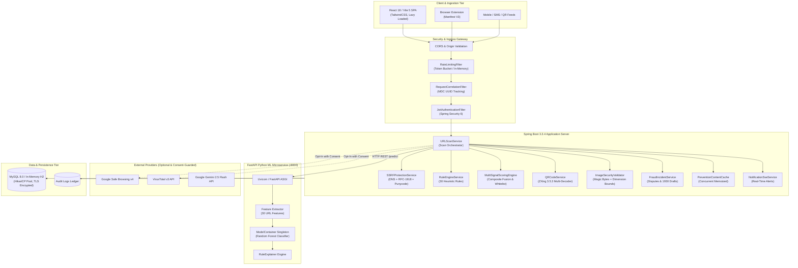
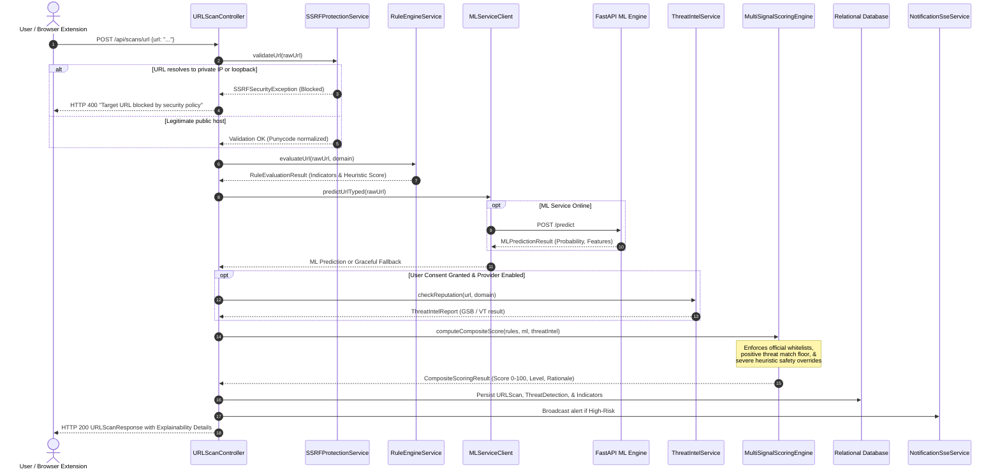
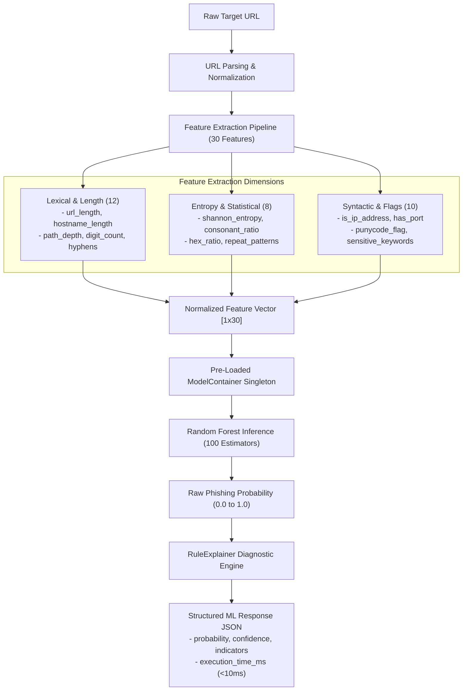
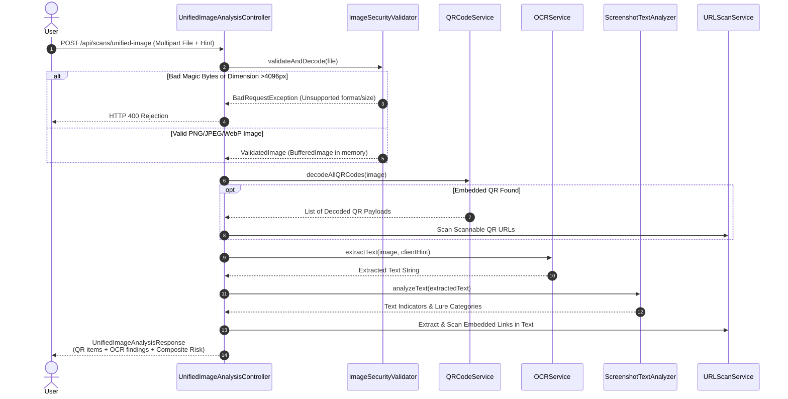
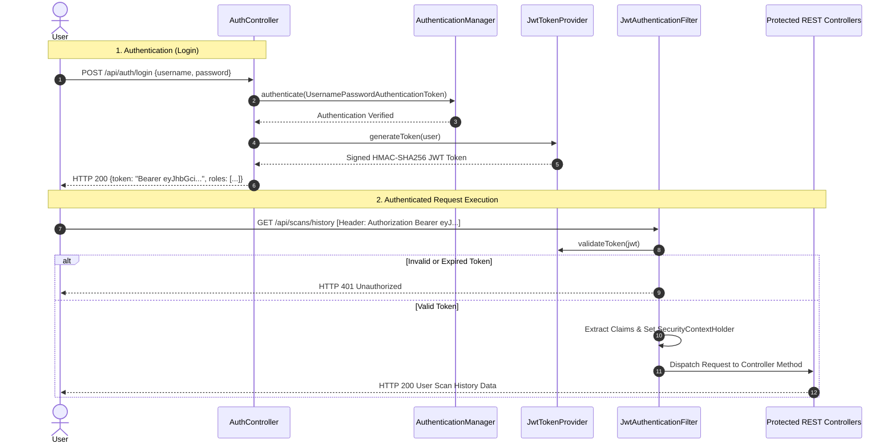
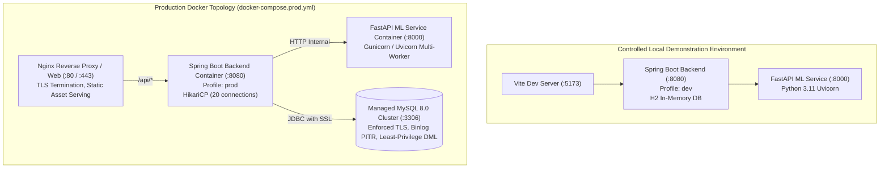

# Prahar Architecture & Data-Flow Diagrams

**Project:** Prahar — Real-Time Multi-Channel AI/ML-Based Phishing Detection and Prevention System  
**Document:** System Architecture & Data-Flow Specifications (Mermaid Diagrams)  
**Status:** FULLY VERIFIED  

---

## 1. Overall System Architecture



---

## 2. URL Scanning and Classification Flow



---

## 3. Machine Learning Inference Flow



---

## 4. Hybrid AI Chatbot Integration Flow

```mermaid
flowchart TD
    USER_QUERY["User Submits Query to Prahar Chatbot"] --> ROUTER{"Is AI Provider Configured<br/>and Enabled?"}

    ROUTER -->|Yes: Gemini API Key Present| LIVE_AI["Construct Security Context Prompt<br/>+ Scanned URL History"]
    ROUTER -->|No: Local Mode / Offline| OFFLINE_NLP["NlpEngine Local Pattern Matcher<br/>(Deterministic Intent Classifier)"]

    LIVE_AI --> CALL_GEMINI["Execute POST to Gemini 2.5 Flash<br/>(Timeout: 15,000ms)"]

    CALL_GEMINI -->|Success (<2500ms)| RETURN_LIVE["Return Live AI Advice with<br/>Cyber Safety Citations"]
    CALL_GEMINI -->|Timeout / API Error| CIRCUIT_FALLBACK["Circuit Breaker Tripped<br/>Seamless Fallback to NlpEngine"]

    OFFLINE_NLP --> INTENT_MATCH{"Intent Matched?<br/>(20+ Supported Topics)"}
    CIRCUIT_FALLBACK --> INTENT_MATCH

    INTENT_MATCH -->|UPI Fraud| T_UPI["1930 Helpline + NPCI Dispute Guide"]
    INTENT_MATCH -->|Card Skimming| T_CARD["Immediate Card Freeze Instructions"]
    INTENT_MATCH -->|OTP Disclosed| T_OTP["Netbanking Password Reset Flow"]
    INTENT_MATCH -->|Phishing Clicked| T_CLICK["Cache Clear + Browser Scan Advisory"]
    INTENT_MATCH -->|General Advice| T_GEN["Safe Browsing Heuristics Guide"]

    T_UPI --> PERSIST["Persist to chat_messages Table"]
    T_CARD --> PERSIST
    T_OTP --> PERSIST
    T_CLICK --> PERSIST
    T_GEN --> PERSIST
    RETURN_LIVE --> PERSIST

    PERSIST --> RESP_OUT["Stream Response to Chat UI (React)"]
```

---

## 5. Multi-Channel Screenshot & QR Analysis Flow



---

## 6. Authentication and Authorization Flow



---

## 7. Deployment Topology (Local & Production Profiles)


