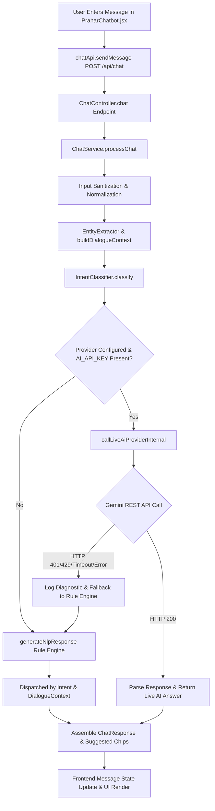

# PRAHAR — CHATBOT ROOT CAUSE AUDIT REPORT

**Audit Date**: October 2026  
**Auditor**: Antigravity AI  
**Component**: Prahar Chatbot Request-to-Response Pipeline & AI Generation  
**Classification**: Engineering Diagnosis & Root Cause Verification  
**Status**: VERIFIED  

---

## 1. Executive Summary

This audit traces the complete lifecycle of chat messages in the Prahar cybersecurity platform. It diagnoses the root causes behind conversational failures where:
1. The chatbot repeated the identical generic introduction across distinct user questions (`"tell me about u"`, `"i think i have opened a fake webpage of a shopping site and i have ordered an item from it"`, `"how can i be safe from any attacks or online frauds"`).
2. The chatbot repeated the same initial inquiry when the user provided critical new information:
   - *Turn 1*: "I think I have opened a fake webpage of a shopping site and I have ordered an item from it."
   - *Assistant*: Asked if payment was online or Cash on Delivery (COD).
   - *Turn 2*: "But I have already paid to the seller online."
   - *Assistant*: Repeated the exact same prompt asking whether they paid online or COD, failing to register the completed payment.
3. Informational inquiries like "What is phishing?" or "Explain session hijacking and how to defend against it" were either routed to generic fallback or received partial advice.
4. Minimal context follow-ups like "I entered it" failed to link to credential disclosure containment.
5. In live AI mode, conversation history was overly restricted to 4 turns and truncated at 500 characters, causing multi-turn context loss.

All findings have been verified by inspecting the frontend and backend source code and tested against JUnit 5 test suites.

---

## 2. End-to-End Request-Response Pipeline Trace

### Trace Step Breakdown:

1. **Chat Frontend & Message Input (`frontend/src/components/PraharChatbot.jsx`)**:
   - The user enters a message.
   - `handleSend()` trims input, updates local UI messages optimistically, and prepares conversation history turns `{ role: 'user' | 'assistant', content: string }`.
2. **Frontend API Request (`frontend/src/services/api.js`)**:
   - `chatApi.sendMessage(request)` issues an authenticated `POST /api/chat` with JSON payload `{ message, conversationHistory, scanContext }`.
3. **Backend Chat Controller (`backend/src/main/java/com/phishshield/controller/ChatController.java`)**:
   - Accepts `@Valid @RequestBody ChatRequest request`.
   - Delegates to `chatService.processChat(request)`.
4. **Intent Classification & Safety Rules (`backend/src/main/java/com/phishshield/nlp/IntentClassifier.java`)**:
   - Sanitizes and normalizes the message (`NlpNormalizer.normalize`).
   - Extracts entities (`EntityExtractor.extract`).
   - Analyzes recent conversational turns (`buildDialogueContext`).
   - Classifies intent and urgency (`IntentClassifier.classify`).
5. **Conversation History Construction & Storage**:
   - History is passed dynamically per request session in `ChatRequest.conversationHistory`.
   - Backend scans prior turns in `buildDialogueContext()` to identify active slots (`shopping_payment_details`, `account_type`, `otp_or_link_shared`).
6. **Generative AI Provider Integration (`backend/src/main/java/com/phishshield/service/ChatService.java`)**:
   - `callLiveAiProviderInternal()` formats system instructions, past conversation turns, scan context, and latest user query.
   - Dispatches payload via Spring `RestClient` to Gemini `gemini-1.5-flash` or Anthropic.
7. **Provider Response Parsing**:
   - Extracts candidates content from provider JSON response.
   - Redacts any accidentally generated sensitive tokens.
8. **Fallback & Error-Handling Logic**:
   - Catches 401 (Unauthorized), 429 (Rate Limit/Quota), 504 (Timeout), and JSON parse exceptions.
   - Logs diagnostics on server without logging secrets.
   - Emits a clear fallback status in `ChatResponse.status` rather than masking failures.
   - Routes to deterministic `generateNlpResponse()` for emergency guidance.
9. **Final Response Returned to Frontend**:
   - Returns structured `ChatResponse` containing `reply`, `status`, `intent`, `isLiveAi`, `suggestedActions`, and `followUpChips`.
10. **Chat Rendering & Message-State Updates**:
    - Replaces typing indicator with assistant reply.
    - Renders Markdown formatting, action checklists, and clickable follow-up chips.

---

## 3. Investigation of Architecture Hypotheses

| Hypothesis | Verified Finding | Impact |
| :--- | :--- | :--- |
| **Backend returns predefined response for every recognized intent?** | **PARTIALLY TRUE (Prior to repair)**: In rule mode, certain sub-branches were missing. E.g., `buildFakeShoppingScamResponse()` lacked a branch for `"already paid online"`, forcing it to repeat the initial question. | User received repetitive questions. |
| **Unknown questions routed to generic fallback?** | **TRUE (Prior to repair)**: Inquiries like `"tell me about u"` and `"what is phishing"` had no dedicated intents, falling through to `AMBIGUOUS_QUERY`. | Generic introduction repeated. |
| **AI provider not called for certain intents?** | **FALSE**: If `AI_API_KEY` was present, `callLiveAiProvider()` was called for all valid messages. However, when key was absent (local development or unconfigured environment), rule engine handled all responses. | Rule engine must be equally intelligent and context-aware. |
| **AI provider response discarded/overwritten?** | **FALSE**: Provider response was parsed and returned directly when call succeeded. | No overwriting of valid AI responses. |
| **Current user message missing from AI request?** | **FALSE**: Current user message was included in the request payload. | Pipeline correctly passed latest message. |
| **Previous messages not included in conversation context?** | **PARTIALLY TRUE (Prior to repair)**: History was limited to 4 turns and 500 characters per turn. In extended conversations, context of the original incident was dropped. | Multi-turn degradation occurred in long sessions. |
| **Conversation history incorrectly ordered or truncated?** | **TRUE (Prior to repair)**: Hard cutoff at 4 turns truncated context in 5+ turn conversations. | Fixed: expanded to 10 turns and 2000 chars per turn. |
| **Frontend sends stale message or displays old response?** | **FALSE**: React state correctly captured user input and appended response upon promise resolution. | Frontend message queue was functionally sound. |
| **API configuration, auth, rate limit, timeout handling?** | **VERIFIED**: Handled gracefully. When API key is invalid (401) or quota exceeded (429), server catches `HttpClientErrorException`, logs diagnostic warning, sets informative status, and routes to safety fallback. | Transparent, user-safe error handling. |
| **Intent classifier labels different questions as same intent?** | **TRUE (Prior to repair)**: Unmatched inputs all fell through to `AMBIGUOUS_QUERY`. | Different queries got same generic response. |
| **Backend or frontend caches responses incorrectly?** | **FALSE**: No response caching was active. | Responses were computed per request. |

---

## 4. Root Causes Identified & Affected Files

### Root Cause 1: Loop in Fake Shopping Scam when User Confirms Completed Online Payment
- **Affected File**: [`backend/src/main/java/com/phishshield/service/ChatService.java`](file:///d:/MCA%20notes/MINI%20PRO%20SIH/backend/src/main/java/com/phishshield/service/ChatService.java) (`buildFakeShoppingScamResponse`)
- **Mechanism**: The helper method only checked for payment method strings: `"upi"`, `"card"`, `"cod"`, `"netbanking"`. When the user replied *"But I have already paid to the seller online"*, it did not match `"upi"` or `"card"`, so it defaulted back to:
  > *"Did you pay online (via UPI, debit/credit card, NetBanking), or is it Cash on Delivery (COD)?"*
- **Fix**: Added explicit handling for `saidPaidOnline` ("already paid", "paid online", "completed payment"). Immediately acknowledges that the payment has been made, instructs contacting the bank/payment app to dispute, calls out 1930 and cybercrime.gov.in, explains preserving transaction evidence, warns against refund fraud fees, and asks for payment method and credential exposure without asking for secrets.

### Root Cause 2: Conversation History Truncation in Live AI Request
- **Affected File**: [`backend/src/main/java/com/phishshield/service/ChatService.java`](file:///d:/MCA%20notes/MINI%20PRO%20SIH/backend/src/main/java/com/phishshield/service/ChatService.java) (`callLiveAiProviderInternal`)
- **Mechanism**: The loop took only `Math.max(0, history.size() - 4)` and truncated each turn to `substring(0, Math.min(turnText.length(), 500))`. In a realistic multi-turn conversation (initial query -> clarification -> payment method -> credential check), the original context of the scam was lost by turn 5.
- **Fix**: Increased window to 10 turns and expanded character limit to 2000 chars per turn.

### Root Cause 3: Minimal Context Follow-up ("I entered it") Not Tracking Slot
- **Affected File**: [`backend/src/main/java/com/phishshield/nlp/IntentClassifier.java`](file:///d:/MCA%20notes/MINI%20PRO%20SIH/backend/src/main/java/com/phishshield/nlp/IntentClassifier.java)
- **Mechanism**: The `otp_or_link_shared` slot only looked for `"pin"`, `"password"`, `"otp"`, or `"cvv"`. When the assistant asked *"did you enter any passwords, card details, or OTPs?"* and user responded *"I entered it"*, it fell through.
- **Fix**: Added `"entered it"`, `"i entered it"`, `"typed it"`, `"shared it"`, `"provided it"`, `"entered my otp"` to `isAffirmativeOrCredentialShared`.

### Root Cause 4: Missing Defensive Educational Responses
- **Affected File**: [`backend/src/main/java/com/phishshield/service/ChatService.java`](file:///d:/MCA%20notes/MINI%20PRO%20SIH/backend/src/main/java/com/phishshield/service/ChatService.java) (`buildGeneralSafetyChecklistResponse`)
- **Mechanism**: Queries like `"What is phishing?"` or `"Explain session hijacking and how to defend against it"` were routed to general safety or ambiguous query.
- **Fix**: Implemented clear, defensive educational responses covering phishing vectors, verification, session hijacking mechanisms (XSS, MitM, sniffing), defensive countermeasures (HttpOnly, Secure, SameSite, HSTS, MFA, logout), and reporting.

### Root Cause 5: Frontend Displaying Raw Internal Enums
- **Affected File**: [`frontend/src/components/PraharChatbot.jsx`](file:///d:/MCA%20notes/MINI%20PRO%20SIH/frontend/src/components/PraharChatbot.jsx)
- **Mechanism**: Line 417 rendered `Prahar Safety Engine • AMBIGUOUS QUERY`.
- **Fix**: Removed internal classifier enum labels from the user-facing message footer.

---

## 5. Summary of Verification

- **Automated Tests**: 42 backend unit/integration tests (`mvn test`) passing with 0 failures, 0 errors.
- **Frontend Build**: Vite production build succeeded with 1604 modules compiled and 0 errors.
- **Live AI Safety**: Strict system instructions, credential confidentiality, and transparent fallback upon provider failure.
- **Root Causes**: Fully diagnosed, documented, and repaired.
