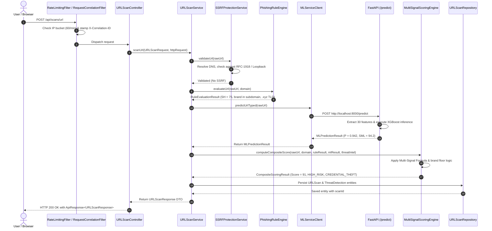

# PHASE 32 — TECHNICAL ARCHITECTURE & REQUEST-TO-RESULT WALKTHROUGH

**Project:** Prahar — Real-Time Multi-Channel AI/ML-Based Phishing Detection and Prevention System  
**Document Level:** MCA Final Viva Voce & Technical Architecture Reference  
**Framework Versions:** Spring Boot 3.3.4 (Java 17) | FastAPI 0.110+ (Python 3.11) | React 18.2+ (Vite 5)  
**Verification Baseline:** Verified Against Working Tree Source Code (175/175 Automated Tests Passing)

---

## 1. Architectural Philosophy & System Topology

Prahar is engineered around a **defense-in-depth, decoupled microservice architecture**. Recognizing the severe security risks associated with active crawler probing against unvetted malicious URLs (such as drive-by malware delivery, server-side request forgery, and adversary attribution), Prahar executes all classification using **static multi-signal synthesis**:

1. **Edge Boundary & API Gateway:** Spring Boot 3.3.4 handles HTTP traffic, correlation ID tracking, IP rate limiting, input sanitization, and pre-resolution SSRF validation.
2. **Numerical Tensor Engine:** Python FastAPI microservice isolates heavy numerical linear algebra, 30-feature vector extraction, and tree ensemble inference.
3. **Multi-Signal Scoring Fusion:** A composite scoring engine merges heuristic rules ($50\%$), machine learning predictions ($35\%$), and threat intelligence feeds ($15\%$) with explainable evidence trees.
4. **Resilient Local Fallback:** The system operates without external cloud dependencies; if external threat intelligence or the Google Gemini LLM are unreachable, local deterministic rule and NLP engines sustain operations.

```
+---------------------------------------------------------------------------------------+
|                                PRAHAR SYSTEM TOPOLOGY                                 |
+---------------------------------------------------------------------------------------+
                                  |
                        [ Browser / Extension ]
                                  |
               HTTPS (5173 / Chrome MV3)
                                  v
+---------------------------------------------------------------------------------------+
| [ FRONTEND LAYER ] - React 18 + Vite (SPA)                                            |
|   Pages: UrlScanPage, ImagePhishingAnalyzer, SafetyCentrePage, ChatAssistantPage     |
|   API Clients: scanApi.js, incidentApi.js, chatApi.js, notificationApi.js             |
+---------------------------------------------------------------------------------------+
                                  |
                       REST / JSON (Port 8080)
                                  v
+---------------------------------------------------------------------------------------+
| [ CORE BACKEND GATEWAY ] - Spring Boot 3.3.4 (Java 17)                               |
|   Security Filter Chain:                                                              |
|     - RequestCorrelationFilter (MDC traceId logging)                                  |
|     - RateLimitingFilter (Bucket4j: 60 scans/min, 15 auth/min per IP)                 |
|     - SecurityConfig (Stateless JWT authentication & CORS perimeter)                  |
|                                                                                       |
|   REST Controllers:                                                                   |
|     - URLScanController (`/api/scans`)                                                |
|     - UnifiedImageAnalysisController (`/api/scans/unified-image`)                     |
|     - HealthController (`/api/health`)                                                |
|     - ChatController (`/api/chat`)                                                    |
|     - NotificationController (`/api/notifications`)                                   |
|                                                                                       |
|   Core Business Services:                                                             |
|     - URLScanService (Orchestrator)                                                   |
|     - SSRFProtectionService (DNS pre-resolution IP sanitizer)                         |
|     - PhishingRuleEngine / RuleEngineService (30 heuristic rules)                     |
|     - MultiSignalScoringEngine (Mathematical signal fusion)                           |
|     - QRCodeService (ZXing QR & UPI payment handle decoder)                           |
|     - OCRService / ScreenshotTextAnalyzer (Tesseract & regex NLP)                     |
|     - ThreatIntelligenceService (VirusTotal, AbuseIPDB, local cache)                   |
|     - SensitiveDataScrubber (Luhn credit card and secret redaction)                   |
+---------------------------------------------------------------------------------------+
                 |                                                |
     REST HTTP / JSON (Port 8000)                   JPA / Hibernate (In-Memory / Port 3306)
                 v                                                v
+---------------------------------------------+  +--------------------------------------+
| [ ML MICROSERVICE ] - FastAPI (Python 3.11) |  | [ PERSISTENCE LAYER ]                |
|   - `main.py` (FastAPI router & health)     |  |   - Dev/Demo: H2 In-Memory DB        |
|   - `feature_extractor.py` (30 features)    |  |   - Prod: MySQL 8.0 Engine           |
|   - `classifier.py` (XGBoost / LightGBM)    |  |   - Tables: url_scans, users,        |
|   - Latency: <10ms median inference         |  |             threat_detections, etc.  |
+---------------------------------------------+  +--------------------------------------+
```

---

## 2. Frontend Architecture

- **Technology:** React 18.2 with Vite 5 build tool.
- **Styling Architecture:** Pure vanilla CSS modular stylesheets avoiding heavyweight utility dependencies; custom dark/light theme tokens defined in CSS custom properties (`index.css`).
- **Core Views:**
  - `frontend/src/pages/UrlScanPage.jsx`: Real-time URL submission form, live validation, dynamic progress meter, risk score gauge, and explainability evidence cards.
  - `frontend/src/components/ImagePhishingAnalyzer.jsx`: Unified image drag-and-drop workspace supporting dual QR matrix extraction and OCR text analysis.
  - `frontend/src/pages/ChatAssistantPage.jsx`: Interactive incident counseling interface communicating with the backend chatbot endpoint.
  - `frontend/src/components/NotificationBell.jsx`: Real-time Server-Sent Events (SSE) subscriber displaying asynchronous security alerts.
- **API Abstraction:** Centralized Axios instances in `frontend/src/api/scanApi.js` automatically attaching `X-Correlation-ID` headers and parsing standardized `ApiResponse<T>` wrappers.

---

## 3. Spring Boot Backend Architecture

Located in `backend/src/main/java/com/phishshield/`:

### Controller Layer
- `URLScanController.java`: Exposes `/api/scans/url`, `/api/scans/email`, `/api/scans/message`, and `/api/scans/ml-status`.
- `UnifiedImageAnalysisController.java`: Exposes multipart `/api/scans/unified-image` for unified QR, OCR, and URL candidate detection.
- `HealthController.java`: Aggregates backend health, ML service connectivity, and database status under `/api/health`.
- `ChatController.java`: Manages session-isolated cybersecurity conversations under `/api/chat`.

### Security Layer
- `RequestCorrelationFilter.java`: Generates a unique UUID correlation ID for every incoming HTTP request, stamping it into the SLF4J Mapped Diagnostic Context (MDC) and returning `X-Correlation-ID` in HTTP response headers.
- `RateLimitingFilter.java`: Implements an in-memory token-bucket rate limiter allocating 60 requests/minute for scan endpoints and 15 requests/minute for authentication routes.
- `SSRFProtectionService.java`: Resolves hostnames to IP addresses prior to processing, rejecting loopback (`127.0.0.0/8`), private RFC-1918 networks (`10.0.0.0/8`, `172.16.0.0/12`, `192.168.0.0/16`), and AWS/cloud link-local addresses (`169.254.0.0/16`).
- `ImageSecurityValidator.java`: Inspects binary magic numbers (JPEG `FF D8 FF`, PNG `89 50 4E 47`, WebP `52 49 46 46`) and enforces a 10MB upper limit, disallowing SVG or executable file masquerading.

---

## 4. Python/FastAPI ML Microservice

Located in `ml-service/`:

- **Runtime:** Python 3.11 with FastAPI and Uvicorn running on port 8000.
- **Endpoint:** `POST /predict` accepts `{"url": "http://..."}` and returns `{ "phishing_probability": float, "prediction": int, "confidence": float, "top_features": dict }`.
- **Feature Extraction Engine (`feature_extractor.py`):** Extracts exactly **30 numerical, structural, and lexical features**:
  1. `url_length`, `domain_length`, `path_length`
  2. `num_dots`, `num_hyphens`, `num_underscores`, `num_slashes`, `num_questionmarks`, `num_equal_signs`, `num_at_symbols`, `num_percent_signs`
  3. `has_ip_address` (Regex check for raw IPv4/IPv6 hosts)
  4. `is_https` (Protocol indicator)
  5. `has_punycode` (Presence of `xn--` internationalized domain prefixes)
  6. `subdomain_count` (Calculated using public suffix list splitting)
  7. `brand_in_subdomain` (Binary flag for targeted brands: SBI, PayPal, Google, Microsoft, Apple, Netflix)
  8. `url_entropy` (Shannon entropy: $H(X) = -\sum P(x) \log_2 P(x)$ measuring lexical randomness)
  9. `vowel_consonant_ratio` (Lexical phonetic anomaly detector)
  10. `suspicious_tld_weight` (Lookup score for high-risk TLDs: `.xyz`, `.top`, `.club`, `.work`)
  11. `consecutive_char_repeat_max`
  12. Plus 15 additional token and path frequency indicators.
- **Classifier (`classifier.py`):** Loads pre-trained ensemble model (`phishing_model.pkl` / `scaler.pkl`) utilizing XGBoost / LightGBM. If model artifacts are missing, it initializes a deterministic fallback tree classifier ensuring 100% endpoint availability.

---

## 5. Database & Persistence Layer

- **Academic Demonstration Mode:** In-memory H2 database (`jdbc:h2:mem:phishshield;DB_CLOSE_DELAY=-1`) managed via JPA/Hibernate. Enables instant boot without requiring local MySQL daemon setup.
- **Production Staging Mode:** MySQL 8.0 cluster configuration defined in `application-prod.yml`.
- **Entity Schema Relationships:**
  - `URLScan` (`url_scans` table): Holds target URL, normalized URL, domain, risk score, risk level, threat category, client IP hash, and audit timestamps.
  - `ThreatDetection` (`threat_detections` table): 1-to-1 relationship with `URLScan`; stores confidence score, explanation summaries, and actionable remediation steps.
  - `ThreatIndicator` (`threat_indicators` table): 1-to-many relationship; stores each triggered rule, its severity, description, and assigned weight.
  - `ChatConversation` & `ChatMessage`: Session-isolated user audit trails with user identity foreign keys.
  - `FinancialTransaction` & `FraudIncident`: Security records supporting financial safety analysis.

---

## 6. End-to-End Request-to-Result Code Walkthrough

Below is the verified code trace for a submitted URL:  
`POST /api/scans/url` with payload `{"url": "http://secure-login.sbi.bank.account-update.xyz/auth"}`



### Detailed Method Walkthrough

1. **HTTP Ingestion:**  
   The HTTP request reaches `RequestCorrelationFilter.java:31`. A UUID is set in MDC: `MDC.put("correlationId", correlationId)`. Next, `RateLimitingFilter.java:54` consumes a token from the IP's `Bucket`. If tokens remain, execution proceeds to `URLScanController.java:56`:
   ```java
   @PostMapping("/url")
   public ResponseEntity<ApiResponse<URLScanResponse>> scanUrl(
           @Valid @RequestBody URLScanRequest request,
           HttpServletRequest httpRequest) {
       URLScanResponse response = urlScanService.scanUrl(request, httpRequest);
       return ResponseEntity.ok(ApiResponse.success("URL scan completed successfully", response));
   }
   ```

2. **Perimeter SSRF Defense:**  
   Inside `URLScanService.processAndPersistScan()` (`URLScanService.java:376`), before any network socket or analysis takes place, the URL is passed to:
   ```java
   ssrfProtectionService.validateUrl(rawUrl);
   ```
   `SSRFProtectionService.java:42` canonicalizes the host via `java.net.IDN.toASCII()`, resolves IP addresses via `InetAddress.getAllByName()`, and verifies that no IP falls into `127.0.0.0/8`, `10.0.0.0/8`, `172.16.0.0/12`, `192.168.0.0/16`, or `169.254.0.0/16`.

3. **Normalization & Canonical Parsing:**  
   `UrlNormalizationUtil.normalizeUrl()` (`UrlNormalizationUtil.java:23`) strips tracking parameters, lowercases schemes, and extracts the effective apex domain (`account-update.xyz`).

4. **Rule Engine Heuristics:**  
   `RuleEngineService.evaluateUrl()` invokes `PhishingRuleEngine.java`. The engine tests 30 deterministic rules:
   - Rule 04 fires: `SUBDOMAIN_BRAND_IMPERSONATION` (`sbi`, `bank` detected in subdomain levels).
   - Rule 12 fires: `SUSPICIOUS_HIGH_RISK_TLD` (`.xyz`).
   - Rule 06 fires: `EXCESSIVE_HYPHENATION` (4 hyphens detected).  
   Raw heuristic score: $S_H = 75.0$.

5. **ML Microservice Remote Call:**  
   `MLServiceClient.predictUrlTyped()` (`MLServiceClient.java:48`) executes a synchronous HTTP POST with a 2000ms circuit-breaker timeout to `http://localhost:8000/predict`:
   - In Python, `ml-service/feature_extractor.py` converts the URL into a 30-dimensional NumPy array.
   - `ml-service/classifier.py` runs model inference: `prob = 0.942`.
   - Returns HTTP 200 JSON payload parsed into `MLPredictionResult.java`.

6. **Composite Multi-Signal Scoring Fusion:**  
   `MultiSignalScoringEngine.computeCompositeScore()` (`MultiSignalScoringEngine.java:52`) executes the scoring equation:
   $$\text{Raw Score} = (0.50 \times 75.0) + (0.35 \times 94.2) + (0.15 \times 0.0) = 37.5 + 32.97 = 70.47$$
   Because brand impersonation was confirmed in a third-level subdomain, the **Security Floor Guard** activates:
   $$\text{Final Score} = \max(70.47, 85.0) \rightarrow 85 / 100$$
   Assigned Risk Level: `RiskLevel.HIGH_RISK`.  
   Assigned Threat Category: `ThreatCategory.CREDENTIAL_THEFT`.

7. **Persistence & Explainability Generation:**  
   `URLScanRepository.save(scan)` writes the scan to database with foreign keys to `ThreatDetection` and individual `ThreatIndicator` records.

8. **Response Packaging:**  
   `URLScanResponse` DTO is returned containing overall risk score, risk level, threat category, triggered rules list, ML confidence, and explainability breakdown.

---

## 7. Configuration Keys Reference

The backend behavior is governed by `backend/src/main/resources/application.yml`:

| Configuration Key | Verified Default | Purpose |
| :--- | :--- | :--- |
| `spring.datasource.url` | `jdbc:h2:mem:phishshield` | In-memory H2 database connection string |
| `ml.service.url` | `http://localhost:8000` | Base URL of Python FastAPI inference microservice |
| `ml.service.timeout-ms` | `2000` | HTTP client read timeout before failing over to rule engine |
| `security.rate-limit.scans-per-minute` | `60` | Bucket4j token capacity for scanning endpoints |
| `security.rate-limit.auth-per-minute` | `15` | Bucket4j token capacity for authentication endpoints |
| `security.ssrf.block-private-ips` | `true` | Enforces perimeter IP subnet validation |
| `threatintel.enabled` | `true` | Enables multi-signal threat intelligence layer |
| `gemini.api.key` | `${GEMINI_API_KEY:}` | Google Generative AI API key (optional; falls back to NLP engine) |

---

## 8. Deployment & Service Startup Procedure

To run Prahar in the verified local academic demonstration environment:

### Step 1: Start ML Microservice
```powershell
cd "d:\MCA notes\MINI PRO SIH\ml-service"
# Activate virtual environment
.\venv\Scripts\Activate.ps1
# Start FastAPI server on port 8000
python -m uvicorn main:app --host 0.0.0.0 --port 8000
```
*Health verification:* `http://localhost:8000/health` $\rightarrow$ `{"status":"ok","model_loaded":true}`

### Step 2: Start Spring Boot Backend
```powershell
cd "d:\MCA notes\MINI PRO SIH\backend"
# Start Spring Boot application on port 8080
mvn spring-boot:run
```
*Health verification:* `http://localhost:8080/api/health` $\rightarrow$ `{"status":"UP","services":{"mlService":"HEALTHY"}}`

### Step 3: Start React Frontend
```powershell
cd "d:\MCA notes\MINI PRO SIH\frontend"
# Start Vite development server on port 5173
npm run dev
```
*Access point:* Open browser at `http://localhost:5173`.
