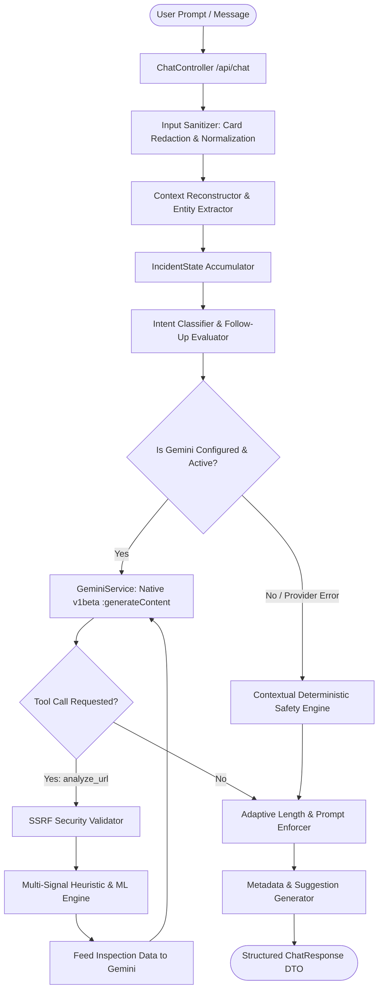

# PRAHAR AI CHATBOT ARCHITECTURE & INTEGRATION SPECIFICATION

**System:** Prahar — Real-Time AI/ML-Based Phishing Detection & Prevention System  
**Module:** Intelligent Cyber Safety Assistant (`ChatService` & `GeminiService`)  
**Design Version:** 2.0 (Dual-Mode Native LLM & Incident State Machine)  

---

## 1. System Overview & Architecture

Prahar's AI Chatbot acts as an expert cybersecurity advisor and incident-containment assistant tailored for Indian citizens facing digital deception, phishing, and financial fraud (UPI scams, credit card theft, unauthorized debits, and credential theft).

The system features **dual-mode operational intelligence**:
1. **Live Generative AI Mode (`GeminiService`):** Connects to Google's official Gemini models (e.g. `gemini-1.5-flash`, `gemini-1.5-pro`) to provide natural, contextual, multi-turn reasoning with tool invocation.
2. **Context-Aware Rule & Safety Engine:** An offline, deterministic fallback engine that activates seamlessly if credentials are missing or the provider is temporarily unavailable. It guarantees 100% uptime with validated Indian cyber law and banking protocols (1930 Helpline, CFCFRMS, CEIR).



---

## 2. Dedicated Gemini Provider (`GeminiService`)

### 2.1 Dual Protocol Support

`GeminiService` supports two HTTP invocation protocols:

1. **Official Native Google Gemini Protocol (Default):**
   - **Endpoint:** `https://generativelanguage.googleapis.com/v1beta/models/{model}:generateContent`
   - **Header:** `x-goog-api-key: <GEMINI_API_KEY>`
   - **Payload Format:**
     ```json
     {
       "systemInstruction": {
         "parts": [{ "text": "<System Prompt + IncidentState Summary>" }]
       },
       "contents": [
         { "role": "user", "parts": [{ "text": "<Previous User Turn>" }] },
         { "role": "model", "parts": [{ "text": "<Previous Assistant Turn>" }] },
         { "role": "user", "parts": [{ "text": "<Current User Message>" }] }
       ],
       "generationConfig": {
         "temperature": 0.2,
         "maxOutputTokens": 400
       }
     }
     ```

2. **OpenAI-Compatible Proxy Protocol (Configurable via `AI_API_URL`):**
   - **Endpoint:** Custom proxy ending in `/chat/completions`
   - **Header:** `Authorization: Bearer <API_KEY>`

### 2.2 Error Categorization & Status Mapping

`GeminiService` monitors live provider health across distinct states:

| Status Code | Description | Provider State | User Experience |
| :--- | :--- | :--- | :--- |
| **UNCONFIGURED** | `AI_PROVIDER=none` | `UNCONFIGURED` | Operates in high-performance rule safety mode. |
| **MISSING_CREDENTIALS** | Provider chosen, API key empty | `MISSING_CREDENTIALS` | Friendly service notice; operates in verified rule safety mode. |
| **CONFIGURED_NOT_TESTED** | Key set, no requests sent yet | `CONFIGURED_NOT_TESTED` | Ready for first message or explicit probe. |
| **PROVIDER_AVAILABLE** | Successful generation or PONG | `PROVIDER_AVAILABLE` | Live Gemini generative AI responses. |
| **PROVIDER_ERROR** | HTTP 401, 404, 429, 503, Timeout | `PROVIDER_ERROR` | Automatic fail-safe fallback to deterministic safety guidance. |

---

## 3. Incident State Machine (`IncidentState`)

Multi-turn dialogues accumulate facts into a structured `IncidentState` model in `DialogueContext`:

```java
public class IncidentState {
    private IncidentType incidentType;          // SUSPICIOUS_LINK_CLICKED, OTP_PIN_DISCLOSED, etc.
    private Boolean linkClicked;                // Confirmed URL click
    private Boolean credentialsEntered;         // Login username/password disclosed
    private Boolean otpOrPinShared;             // OTP or UPI PIN shared
    private Boolean bankDetailsEntered;         // Card number, CVV, or NetBanking ID entered
    private Boolean moneyLost;                  // Confirmed financial deduction
    private Boolean appInstalled;               // Malicious APK / AnyDesk / Screen share
    private String paymentChannel;              // UPI, DEBIT_CARD, CREDIT_CARD, NETBANKING
    private String amount;                      // Monetary amount involved
    private String institution;                 // Bank name (e.g. SBI, HDFC, ICICI)
    private String transactionRef;              // UTR / Reference number
    private Boolean reportedTo1930;             // Whether user already contacted helpline
    private final List<String> completedActions = new ArrayList<>();
}
```

### State Machine Lifecycle
1. **Extraction & Merging:** Every user turn is scanned by `EntityExtractor`. Any new confirmed facts (e.g., amount, bank, link click, OTP disclosure) update `IncidentState`.
2. **Anti-Repetition Prompt Synthesis:** `incidentState.toPromptSummary()` generates a high-priority prompt section:
   ```
   [Confirmed Incident State - Do NOT re-ask these details]:
   - Link Clicked: Yes
   - OTP or PIN Disclosed: Yes
   - Affected Bank/Service: SBI
   - Priority Directive: Focus on freezing SBI electronic channels and Golden Hour 1930 reporting.
   ```
3. **No Redundant Questioning:** If `otpOrPinShared` is `true`, the assistant immediately gives containment advice and will never ask *"Did you share your OTP?"*.

---

## 4. Server-Side Tool Calling & Safety Grounding

`GeminiService` enables native function execution with strict server-side validation:

### Supported Tools:
1. **`analyze_url(url: string)`**
   - Validates URL against SSRF protection (`SsrfProtectionService`) to block localhost, AWS metadata (`169.254.169.254`), and private RFC 1918 addresses.
   - Evaluates URL lexical heuristics, brand impersonation, and entropy.
   - Returns structured score (0–100), risk level (`HIGH_RISK`, `SAFE`), and indicators.
2. **`explain_scan_result(scan_id: integer)`**
   - Queries `URLScanRepository` for verified database findings.
   - Injects canonical scan summary into LLM context, forbidding hallucinations or contradiction of verified scan verdicts.

---

## 5. Indian Cybersecurity & Banking Directives

The system is configured with explicit directives for Indian financial and digital infrastructure:

- **1930 National Cyber Crime Helpline:** Always recommended within the **Golden Hour (first 2–3 hours)** of financial fraud to trigger automated freezing via the Indian Cybercrime Coordination Centre (I4C) CFCFRMS platform.
- **National Portal:** [cybercrime.gov.in](https://cybercrime.gov.in/) for formal evidence lodging.
- **TRAI DND & 1909:** For SMS smishing and fake delivery notifications.
- **CEIR (ceir.gov.in):** Central Equipment Identity Register for blacklisting lost/stolen device IMEIs.
- **UPI QR Clarification:** Clarifies that receiving money on UPI **never requires scanning a QR code or entering a UPI PIN**.

---

## 6. Adaptive Detail & Response Conciseness

The assistant detects the user's intent and explicit preferences to adapt response length:
- **Simple Definitions (`What is phishing?`, `What is OTP?`):** Default to roughly 1–3 short sentences (20–60 words) without redundant headers or bulleted checklists.
- **Incident Containment (`I gave my OTP`):** Prioritizes urgent containment actions first (block channels, call 1930).
- **Comprehensive Requests (`in detail`, `step by step`):** Expands up to 1024 tokens for in-depth educational guidance.
