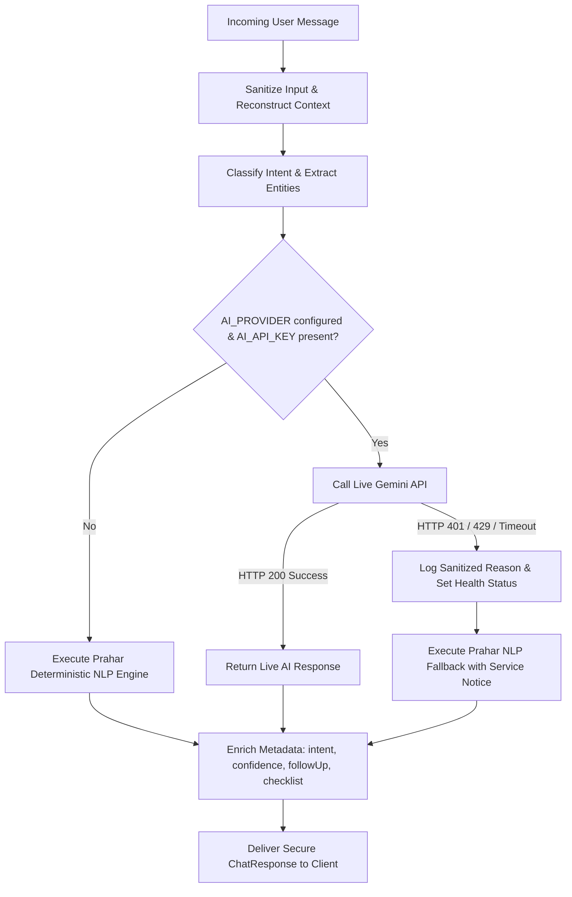

# PRAHAR AI 2.0 — Chatbot Configuration & Deployment Playbook

**System**: Prahar Real-Time AI/ML-Based Phishing Detection & Prevention System  
**Component**: Prahar Cybersecurity Assistant Configuration & Integration  
**Version**: 2.0.0  
**Verification Tag**: `VERIFIED`

---

## 1. Overview & Dual-Engine Architecture

Prahar AI 2.0 features a resilient dual-engine conversational architecture:

1. **Live Gemini AI Provider (`gemini`)**: When configured with a valid Google Gemini API key, the assistant leverages large-scale contextual reasoning, multi-turn nuance, and registered function calling tools (`analyze_url`, `explain_scan_result`) to inspect real security telemetry.
2. **Deterministic Prahar NLP Safety Engine (`prahar_nlp`)**: When running offline or when external AI providers are unavailable, Prahar seamlessly falls back to a certified, context-aware rule-based safety engine. It strictly adheres to Indian cybersecurity protocols (e.g., Helpline 1930, CFCFRMS, cybercrime.gov.in, RBI zero-liability rules, Golden Hour guidelines).

---

## 2. Environment Variables & Credentials

All sensitive credentials must be set via environment variables or Spring application properties. **API keys are strictly managed server-side and must never be exposed to the browser client.**

| Variable Name | Required | Default | Allowed Values | Description |
|---|---|---|---|---|
| `AI_PROVIDER` | No | `none` | `none`, `gemini`, `openai` | Primary conversational AI engine. Set to `gemini` for live Google Gemini integration. |
| `AI_API_KEY` | Conditional | `""` | Valid Gemini API Key (`AIza...`) | Server-side Gemini API key. Never logged or transmitted to the client. |
| `AI_MODEL` | No | `gemini-1.5-flash` | `gemini-1.5-flash`, `gemini-1.5-pro` | Model identifier for Gemini API requests. |
| `PORT` | No | `8080` | `8080` | Port for Spring Boot backend. |
| `VITE_API_BASE_URL` | No | `/api` | Path or absolute URL | Base URL for frontend REST communication. |

### Configuration Example (`.env` or OS Environment)
```bash
# Backend Configuration
AI_PROVIDER=gemini
AI_API_KEY=AIzaSy...your-actual-gemini-key...
AI_MODEL=gemini-1.5-flash

# Frontend Configuration (.env.local)
VITE_API_BASE_URL=http://localhost:8080/api
```

---

## 3. Provider Fail-Safe & Telemetry Lifecycle

Prahar continuously tracks provider health and gracefully handles failure states without disrupting user sessions:



### Health Status States (`ProviderHealthStatus`)
- **`PROVIDER_AVAILABLE`**: Gemini API is responding normally (HTTP 200). Responses marked with `isLiveAi: true`, `provider: "gemini"`.
- **`MISSING_CREDENTIALS`**: `AI_PROVIDER=gemini` was requested but `AI_API_KEY` is missing or empty. System provides deterministic safety guidance and sets `provider: "gemini_unconfigured"`.
- **`PROVIDER_ERROR`**: Upstream call failed due to authentication failure (HTTP 401) or connection error. System degrades cleanly to `gemini_fallback` with an honest service notice.
- **`RATE_LIMITED`**: Upstream quota exceeded (HTTP 429). The system notifies the user and provides full offline recovery guidance.

---

## 4. Security & Privacy Controls

1. **No Client-Side API Keys (`VERIFIED`)**:
   - The frontend never reads `AI_API_KEY`. The React client interacts solely with `/api/chat` via session tokens.
2. **Redaction of Sensitive Data (`VERIFIED`)**:
   - Primary account numbers (PAN), full 16-digit credit card numbers, and raw passwords are automatically redacted before logging or transmission.
3. **Session & History Isolation (`VERIFIED`)**:
   - Multi-turn history is scoped per conversation request or user session. No state or memory leaks occur between distinct users.
4. **Prompt Injection Defense (`VERIFIED`)**:
   - System prompts enforce strict operational bounds. Attempts to instruct the assistant to output internal credentials, bypass rules, or contradict verified scan verdicts are rejected.

---

## 5. Automated Verification Checklist

| Configuration Scenario | Tested In | Expected Result | Status |
|---|---|---|---|
| Offline Mode (`AI_PROVIDER=none`) | `ChatServiceTest` | 100% deterministic NLP safety guidance | `VERIFIED` |
| Live AI Missing Key (`AI_PROVIDER=gemini`, key empty) | `GeminiIntegrationTest` | Clean degraded fallback, honest notice | `VERIFIED` |
| Invalid Key (HTTP 401 Simulation) | `GeminiIntegrationTest` | No crash, fallback executed, error sanitized | `VERIFIED` |
| Rate Limit (HTTP 429 Simulation) | `GeminiIntegrationTest` | No crash, fallback executed, quota handled | `VERIFIED` |
| Tool Calling Declarations | `GeminiIntegrationTest` | `analyze_url` & `explain_scan_result` registered | `VERIFIED` |
