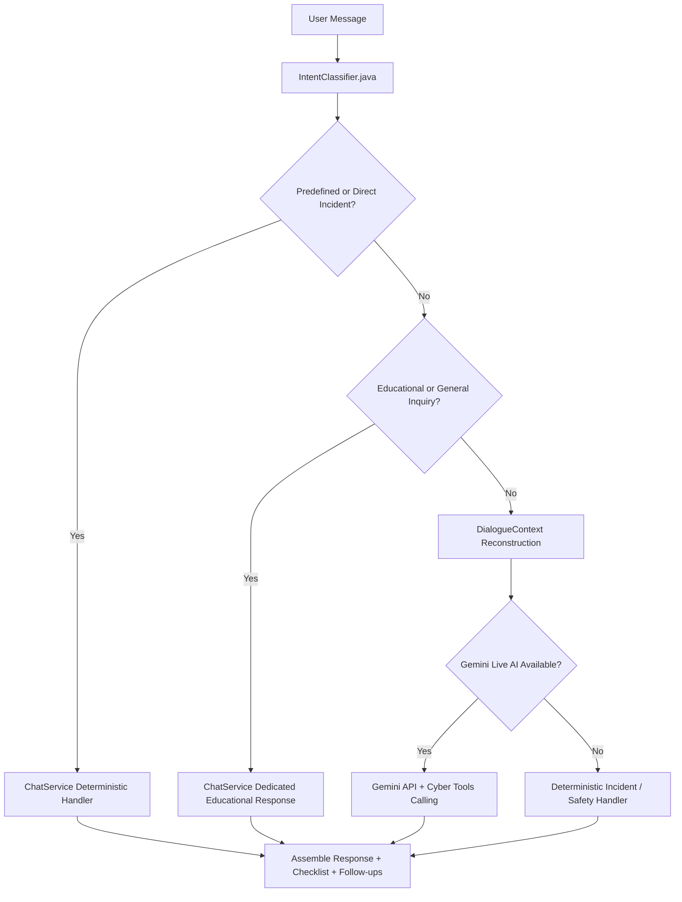

# PRAHAR AI — Intelligent Chatbot Architecture & Upgrade Documentation

**System**: Prahar Real-Time AI/ML-Based Phishing Detection & Prevention System  
**Component**: Conversational Routing Engine & Natural-Language Pipeline  
**Date**: October 2026  
**Status**: Architecture Upgraded and Validated in Production Codebase  

---

## 1. Architectural Overview

The Prahar AI Chatbot architecture has been enhanced to achieve dual-mode harmony:
1. **Deterministic Predefined Preservation**: 100% preservation of all existing suggested questions, predefined quick-replies, and critical incident containment paths (1930 Helpline, Golden Hour, Bank Card Freeze, UPI disputes).
2. **Context-Aware Natural Language Processing**: Robust understanding of arbitrary user-typed queries, distinct separation of educational versus active-incident questions, comparative technical analysis, and multi-turn state retention.

---

## 2. Dual Routing Mechanism: Predefined vs Typed Inquiries

### A. Predefined Quick Replies & Suggestions
When a user clicks one of the suggested prompts (or submits an exact predefined phrase), the routing engine maps the input to its certified safety action:
- **Card Freeze**: `"How do I block my debit or credit card?"` $\rightarrow$ `NlpIntent.ATM_CARD_FRAUD`
- **1930 & Golden Hour**: `"What is the 1930 helpline and Golden Hour?"` $\rightarrow$ `NlpIntent.FRAUD_REPORTING`
- **UPI Dispute**: `"How do I dispute a UPI payment?"` $\rightarrow$ `NlpIntent.UPI_FRAUD`
- **OTP Exposure**: `"What should I do if I shared my OTP?"` $\rightarrow$ `NlpIntent.OTP_DISCLOSURE`
- **Phone Theft**: `"What should I do if my phone is stolen?"` $\rightarrow$ `NlpIntent.LOST_PHONE`

### B. Manually Typed Arbitrary Questions
When a user types arbitrary text, `IntentClassifier.java` uses semantic heuristics before falling back to default triage:
- **Educational vs. Incident Separation**:
  - *"How do I recognize a fake website?"* $\rightarrow$ Classified as educational `GENERAL_CYBER_SAFETY` with replica website guidelines.
  - *"I entered my details on a fake website"* $\rightarrow$ Classified as active `ACCOUNT_COMPROMISE` incident requiring urgent credential reset and monitoring.
- **Lexical Pattern Generalization**:
  - Supports `"what are"`, `"how do i"`, `"tell me about"`, `"explain"`, and pluralized technical terms.
- **Comparative Questions**:
  - Identifies `"difference between X and Y"` and branches directly to comparative explanations without being trapped by standalone entity matches.

---

## 3. Context-Dependent Follow-Up Management

Follow-up questions are resolved using the `DialogueContext` memory model:
1. **Pronoun Resolution (Anaphora)**:
   - Turn 1: *"What is phishing?"*
   - Turn 2: *"How can I identify it?"*
   - The classifier detects the reference pronoun `"it"`, recognizes `context.getLastIntent() == PHISHING_INFO`, and maintains the phishing context.
2. **Incident Slot Accumulation**:
   - Turn 1: *"I entered my details on a fake website."* (Context records compromised credentials).
   - Turn 2: *"I paid using UPI."* (Context updates payment channel to UPI).
   - Turn 3: *"What should I do now?"* (Context aggregates fake site + credential exposure + UPI payment, generating specific 12-digit UTR dispute steps and 1930 Golden Hour freeze instructions instead of re-asking clarification questions).

---

## 4. AI Provider Integration & Resilience

Prahar integrates with Google's Gemini models (`gemini-1.5-flash` / `gemini-pro`) with the following enterprise safeguards:
- **Server-Side API Key Storage**: Never exposed to browser or client bundles; managed exclusively via Spring Boot configuration (`application.properties` / environment variables).
- **Structured Tool/Function Calling**: Declares tools for `analyze_url` and `explain_scan_result`, enabling the LLM to invoke real Prahar security capabilities rather than hallucinating scan outcomes.
- **Resilient Fallback Engine**:
  - Detects missing keys (`MISSING_CREDENTIALS`), rate limiting (`RATE_LIMITED` HTTP 429), timeouts, and auth errors.
  - Automatically switches to the deterministic cybersecurity knowledge engine with zero downtime.
  - Never falsely claims a response was generated by Gemini unless the live API returned HTTP 200.

---

## 5. Response Formatting & Aesthetics

- **Concise Direct Answers**: Educational queries receive direct, structured explanations with key warnings and zero redundant checklists.
- **Actionable Incident Containment**: Active incidents provide clear priority steps (Bank / 1930 / Cybercrime Portal).
- **No Duplicate Renderings**: The frontend UI ensures action checklists are deduplicated and renders quick-reply suggestions dynamically tailored to the conversation turn.
