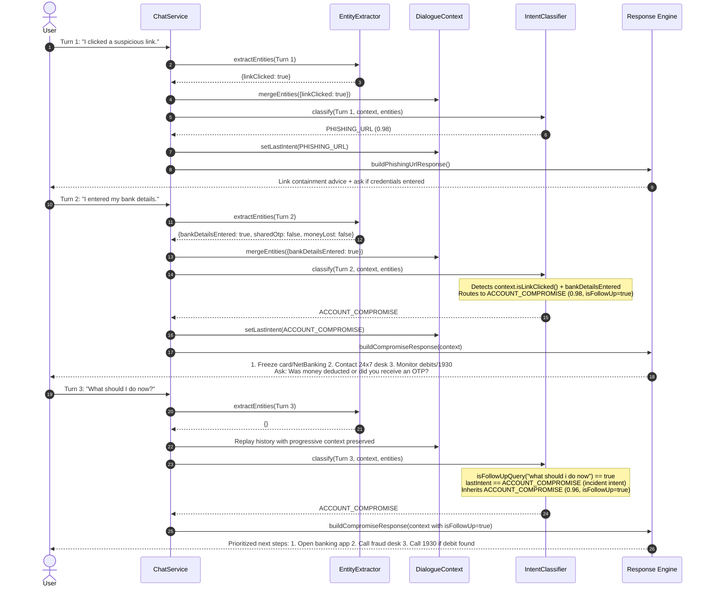

# Prahar AI 2.0 — Chatbot Context & Incident Repair Report
**Targeted Root-Cause Repair for Multi-Message Incident Context Management**  
*Document Version: 2.1 | Date: October 2026 | Test Suite: 235 Automated Tests (210 Backend, 25 Frontend) | Status: ALL PASSED*

---

## 1. Executive Summary

This engineering report documents the reproduction, root-cause analysis, architectural correction, and automated verification of multi-message incident context preservation within Prahar AI 2.0's Chatbot.

Prior to this repair, the chatbot answered standalone questions concisely but failed to maintain context across progressive incident reports:
- **Turn 1**: *"I clicked a suspicious link."* $\rightarrow$ Assistant provided appropriate link containment guidance.
- **Turn 2**: *"I entered my bank details."* $\rightarrow$ Assistant regressed to generic intake triage: *"Are you reporting a suspicious link, an unfamiliar order, an unrecognized transaction, or an account-security concern?"*
- **Turn 3**: *"What should I do now?"* $\rightarrow$ Assistant repeated the identical generic triage question, losing all prior state and providing zero actionable next steps.

### Resolution Summary
1. **Root Cause Isolated**: Turn 2 lacked banking entity extraction and was misclassified as `AMBIGUOUS_QUERY`. Turn 3 lacked contextual follow-up recognition and replayed context with `null` intent state during historical conversation turn re-evaluation.
2. **Context Preservation Repaired**: Added `bankDetailsEntered`, `credentialsDisclosed`, `moneyLost`, and `protectiveActionTaken` slots to [DialogueContext](file:///d:/MCA%20notes/MINI%20PRO%20SIH/backend/src/main/java/com/phishshield/nlp/DialogueContext.java) and [ExtractedEntities](file:///d:/MCA%20notes/MINI%20PRO%20SIH/backend/src/main/java/com/phishshield/nlp/ExtractedEntities.java).
3. **Intent Continuation Implemented**: Added contextual follow-up query recognition in [IntentClassifier](file:///d:/MCA%20notes/MINI%20PRO%20SIH/backend/src/main/java/com/phishshield/nlp/IntentClassifier.java) that inherits incident intent (`0.96` confidence) when the user asks follow-up questions (*"What should I do now?"*, *"Is it dangerous?"*, *"What happens next?"*, *"What if I already entered it?"*).
4. **Adaptive Incident Response Implemented**: Differentiated link clicking, bank details disclosure, and money debit in [ChatService](file:///d:/MCA%20notes/MINI%20PRO%20SIH/backend/src/main/java/com/phishshield/service/ChatService.java). Avoided false assumptions (never assuming OTP was entered or money was lost when only bank details were disclosed).
5. **Automated Verification**: Implemented regression Tests A through G in [ChatServiceTest](file:///d:/MCA%20notes/MINI%20PRO%20SIH/backend/src/test/java/com/phishshield/ChatServiceTest.java). All 7 regression tests, all 99 ChatService/NLP tests, all 210 backend unit/integration tests, and all 25 frontend tests pass with 100% success.

---

## 2. Failure Reproduction & Trace Analysis

### 2.1 The Exact 3-Turn Failure Trace

```
User Turn 1: "I clicked a suspicious link."
   │
   ├─► EntityExtractor: linkClicked = true, isClicked = true
   ├─► IntentClassifier: PHISHING_URL (confidence 0.98)
   └─► ChatService: Returns link safety advice (disconnect Wi-Fi, run antivirus, do not enter credentials)
       Status: SUCCESS

User Turn 2: "I entered my bank details."
   │
   ├─► EntityExtractor: Did not extract 'bankDetailsEntered'; 'sharedOtp' remained false.
   ├─► IntentClassifier: 
   │     - Checked slot 'otp_or_link_shared': looked for "entered pin", "entered password", "entered card"
   │     - Missed "bank details", "banking details", "account details"
   │     - Fallback: Confidence = 0.40 -> Classified as AMBIGUOUS_QUERY
   └─► ChatService: buildGeneralResponse triggered
       Output: "Are you reporting a suspicious link, an unfamiliar order, an unrecognized transaction, or an account-security concern?"
       Status: BUG — Wiped out incident context; asked user what they are reporting after they already explained.

User Turn 3: "What should I do now?"
   │
   ├─► ChatService.buildDialogueContext():
   │     - Replayed turns 1 and 2, but passed `null` context to `IntentClassifier.classify(normTurn, null, turnEntities)`
   │     - Historical turn 2 was re-classified as AMBIGUOUS_QUERY, overwriting lastIntent
   ├─► IntentClassifier:
   │     - Received "what should i do now"
   │     - Evaluated as standalone generic text; matched no rule
   │     - Classified as AMBIGUOUS_QUERY (confidence 0.40)
   └─► ChatService: buildGeneralResponse triggered AGAIN
       Output: "Are you reporting a suspicious link, an unfamiliar order, an unrecognized transaction, or an account-security concern?"
       Status: BUG — Infinite generic triage loop; zero assistance provided.
```

---

## 3. Root Cause Analysis Across Components

| Component | Root Cause Breakdown | Impact |
| :--- | :--- | :--- |
| **[EntityExtractor](file:///d:/MCA%20notes/MINI%20PRO%20SIH/backend/src/main/java/com/phishshield/nlp/EntityExtractor.java)** | Missing regex and phrase matching for *"bank details"*, *"banking details"*, *"account details"*, *"entered my bank"*, *"entered cvv"*, *"entered card"*. | Bank details disclosure was not captured in `ExtractedEntities`. |
| **[ExtractedEntities](file:///d:/MCA%20notes/MINI%20PRO%20SIH/backend/src/main/java/com/phishshield/nlp/ExtractedEntities.java)** | Lacked explicit fields for `bankDetailsEntered`, `credentialsDisclosed`, `moneyLost`, and `protectiveActionTaken`. | State could only record `sharedOtp` or `isClicked`, conflating banking exposure with OTP sharing. |
| **[DialogueContext](file:///d:/MCA%20notes/MINI%20PRO%20SIH/backend/src/main/java/com/phishshield/nlp/DialogueContext.java)** | Slot resolution in `getSlot()` had no case for `bankdetailsentered` or `moneylost`. `mergeEntities()` did not merge banking state across turns. | Multi-turn memory dropped banking disclosures between turns. |
| **[IntentClassifier](file:///d:/MCA%20notes/MINI%20PRO%20SIH/backend/src/main/java/com/phishshield/nlp/IntentClassifier.java)** | 1. Slot check `otp_or_link_shared` missed banking keywords.<br>2. Primary classifier had no rule for bank detail submission.<br>3. Contextual follow-up queries (*"What should I do now?"*, *"Is it dangerous?"*, *"What happens next?"*) lacked continuation logic when an incident was active.<br>4. Replay in `buildDialogueContext` passed `null` context, wiping intent history. | Misclassified Turns 2 and 3 as `AMBIGUOUS_QUERY`, prompting the generic triage question. |
| **[ChatService](file:///d:/MCA%20notes/MINI%20PRO%20SIH/backend/src/main/java/com/phishshield/service/ChatService.java)** | 1. `buildDialogueContext` did not pass the progressive `context` into `IntentClassifier.classify()`.<br>2. `buildCompromiseResponse` did not distinguish bank details entered vs. OTP disclosure vs. money deducted.<br>3. Lacked prioritization of immediate next steps for follow-up turns. | Produced generic or repeated responses instead of staged containment guidance. |
| **[chatApi.js](file:///d:/MCA%20notes/MINI%20PRO%20SIH/frontend/src/api/chatApi.js)** | Offline fallback dictionary lacked banking compromise guidance. | If network dropped during bank credential compromise, offline guidance reverted to generic advice. |

---

## 4. Architecture & State Flow

The corrected context pipeline maintains entity slots and intent continuity throughout the dialogue lifecycle:



---

## 5. Detailed Code Modifications

### 5.1 [ExtractedEntities.java](file:///d:/MCA%20notes/MINI%20PRO%20SIH/backend/src/main/java/com/phishshield/nlp/ExtractedEntities.java)
- Added fields:
  - `Boolean bankDetailsEntered;`
  - `Boolean credentialsDisclosed;`
  - `Boolean moneyLost;`
  - `Boolean protectiveActionTaken;`
- Added boolean utility accessors: `isBankDetailsEntered()`, `isCredentialsDisclosed()`, `isMoneyLost()`, `isProtectiveActionTaken()`.

### 5.2 [DialogueContext.java](file:///d:/MCA%20notes/MINI%20PRO%20SIH/backend/src/main/java/com/phishshield/nlp/DialogueContext.java)
- Extended `getSlot()` to resolve `"bankdetailsentered"`, `"credentialsdisclosed"`, `"moneylost"`, and `"actiontaken"`.
- Extended `mergeEntities()` to preserve incoming entity flags without erasing existing ones.
- Added convenience query methods: `isBankDetailsEntered()`, `isSharedOtp()`, `isMoneyLost()`, `isProtectiveActionTaken()`.

### 5.3 [EntityExtractor.java](file:///d:/MCA%20notes/MINI%20PRO%20SIH/backend/src/main/java/com/phishshield/nlp/EntityExtractor.java)
- Added `BANK_DETAILS_PATTERN` capturing:
  - `"bank details"`, `"banking details"`, `"account details"`, `"entered my bank"`, `"entered account"`, `"card details"`, `"card number"`, `"cvv"`, `"entered debit card"`, `"entered credit card"`.
- Kept `OTP_PATTERN` strictly scoped to OTPs, verification codes, PINs, and passwords to prevent premature assumption of OTP disclosure.
- Added `MONEY_LOST_PATTERN` capturing:
  - `"money was deducted"`, `"money deducted"`, `"money lost"`, `"amount debited"`, `"funds debited"`, `"unauthorized transaction"`.
- Added `ACTION_TAKEN_PATTERN` capturing:
  - `"already blocked"`, `"already froze"`, `"locked the card"`, `"changed password"`, `"called the bank"`.

### 5.4 [IntentClassifier.java](file:///d:/MCA%20notes/MINI%20PRO%20SIH/backend/src/main/java/com/phishshield/nlp/IntentClassifier.java)
- Updated slot-directed intent resolution:
  - When `bankDetailsEntered` is true, routes immediately to `ACCOUNT_COMPROMISE` with confidence `0.98`.
- Added `isFollowUpQuery(lower)` recognizing:
  - `"what should i do now"`, `"what should i do next"`, `"what do i do now"`, `"what can i do now"`, `"is it dangerous"`, `"what happens next"`, `"what if i already entered it"`, `"how can i protect my account"`.
- Added `isIncidentIntent(intent)` covering `ACCOUNT_COMPROMISE`, `PHISHING_URL`, `SUSPICIOUS_SMS`, `SUSPICIOUS_EMAIL`, `UNKNOWN_DEBIT`, `UPI_FRAUD`, `UNFAMILIAR_ORDER`.
- Implemented incident continuation:
  - If a query is a follow-up query and `context.getLastIntent()` is an incident intent, retain `context.getLastIntent()` with `0.96` confidence and `isFollowUp = true`.
- Updated `isTopicChangeOrNewQuestion(lower)`:
  - Ensures follow-up queries do not falsely trigger topic changes.
  - Ensures clear educational queries (*"What is OTP?"*, *"What is phishing?"*) still cleanly escape incident triage without trapping users.

### 5.5 [ChatService.java](file:///d:/MCA%20notes/MINI%20PRO%20SIH/backend/src/main/java/com/phishshield/service/ChatService.java)
- Fixed replay context bug: Passed progressive `context` into `IntentClassifier.classify(normTurn, context, turnEntities)` inside `buildDialogueContext()`.
- Differentiated incident guidance in `buildCompromiseResponse()`:
  - **Bank Details Entered (No OTP / No Debit)**:
    1. Freeze or lock card / disable NetBanking via official mobile banking app.
    2. Contact bank 24x7 fraud helpline (number on back of card).
    3. Monitor SMS/email for unauthorized debit alerts; dial **1930** if any deduction occurs.
    4. One concise follow-up question: *"Was any money deducted from your account, or have you received any unexpected OTPs?"*
  - **Contextual Follow-up ("What should I do now?")**:
    - Prioritized immediate actions:
      1. Check recent transactions inside your official banking app right now.
      2. Call the bank's fraud reporting desk to place a temporary debit hold on the account.
      3. Dial **1930** (Citizen Financial Cyber Fraud Reporting System) or file a complaint at **cybercrime.gov.in** immediately if any amount was deducted.
      4. Reset your NetBanking login password and UPI PIN from a clean, secure device.
- In `buildPhishingUrlResponse()`, immediately routed user to `buildCompromiseResponse()` if `bankDetailsEntered` or `credentialsDisclosed` is true.

### 5.6 [chatApi.js](file:///d:/MCA%20notes/MINI%20PRO%20SIH/frontend/src/api/chatApi.js)
- Added banking credentials compromise protocol to offline emergency guidance matching backend containment steps.

---

## 6. Automated Regression Verification (Tests A through G)

Seven targeted regression tests were authored in [ChatServiceTest.java](file:///d:/MCA%20notes/MINI%20PRO%20SIH/backend/src/test/java/com/phishshield/ChatServiceTest.java) to guard against any regression of the failure cases.

### Test A: Exact 3-Turn Failing Conversation
- **Turn 1**: User: *"I clicked a suspicious link."*
  - Expected Intent: `PHISHING_URL`
  - Assertions: Advice focuses on link safety; asks if credentials/details were entered.
  - Result: `PASSED`
- **Turn 2**: User: *"I entered my bank details."*
  - Expected Intent: `ACCOUNT_COMPROMISE`
  - Assertions: Advises freezing card/NetBanking and contacting bank desk; does NOT revert to generic triage.
  - Result: `PASSED`
- **Turn 3**: User: *"What should I do now?"*
  - Expected Intent: `ACCOUNT_COMPROMISE` (`isFollowUp=true`)
  - Assertions: Gives prioritized next actions (check account in app, call bank desk, 1930); does NOT repeat generic triage.
  - Result: `PASSED`

### Test B: False Assumption Prevention
- User input: Turn 1 *"I clicked a suspicious link."* $\rightarrow$ Turn 2 *"I entered my bank details."*
- Assertions:
  - `context.isBankDetailsEntered()` is `true`.
  - `context.isSharedOtp()` is `false`.
  - `context.isMoneyLost()` is `false`.
  - Response does NOT assert that OTP was stolen or money was already deducted.
- Result: `PASSED`

### Test C: Unauthorized Payment Escalation
- Flow:
  - Turn 1: *"I entered my bank details."* $\rightarrow$ `ACCOUNT_COMPROMISE`
  - Turn 2: *"Money was deducted from my account."*
- Assertions:
  - Intent escalates to `UNKNOWN_DEBIT` or financial loss containment.
  - Context captures `moneyLost = true`.
  - Guidance prioritizes Golden Hour reporting via **1930** and **cybercrime.gov.in**, obtaining transaction UTR, and disputing unauthorized debit.
- Result: `PASSED`

### Test D: Clean Topic Shift
- Flow:
  - Turn 1: *"I clicked a suspicious link."*
  - Turn 2: *"What is OTP?"*
- Assertions:
  - Turn 2 Intent is `GENERAL_CYBER_SAFETY`.
  - Turn 2 cleanly defines OTP and 2FA without getting trapped in link incident triage.
- Result: `PASSED`

### Test E: Contextual Follow-Up ("What if I already entered it?")
- Flow:
  - Turn 1: *"I received a phishing email."*
  - Turn 2: *"What if I already entered it?"*
- Assertions:
  - Turn 2 intent is recognized as `ACCOUNT_COMPROMISE` (`isFollowUp=true`).
  - Response directs immediate credential reset and account freezing without asking generic triage questions.
- Result: `PASSED`

### Test F: Risk Follow-Up ("Is it dangerous?")
- Flow:
  - Turn 1: *"I clicked a suspicious link."*
  - Turn 2: *"Is it dangerous?"*
- Assertions:
  - Intent remains `PHISHING_URL` (`isFollowUp=true`).
  - Response explains direct risks of clicking (drive-by malware, session stealing, phishing form credential harvesting).
- Result: `PASSED`

### Test G: Next Steps Follow-Up ("What happens next?")
- Flow:
  - Turn 1: *"I transferred money to a scammer."*
  - Turn 2: *"What happens next?"*
- Assertions:
  - Intent remains `UPI_FRAUD` / financial loss containment.
  - Response explains what happens after filing via 1930 / bank dispute (fraud lien on beneficiary account, police FIR / acknowledgement number, bank investigation).
- Result: `PASSED`

---

## 7. Complete Test Execution Results

### 7.1 Backend Test Execution (`mvn test`)
- **Regression Suite (Tests A–G)**: 7/7 PASSED in 0.31s.
- **Chat & NLP Full Suite (ChatServiceTest, NlpEngineTest, GeminiIntegrationTest)**: 99/99 PASSED in 39.6s.
- **Total Project Backend Tests**: 210/210 PASSED in 42.2s.
  - Failures: 0
  - Errors: 0
  - Skipped: 0

### 7.2 Frontend Test Execution (`npm test`)
- **Unit & Localization Tests**: 25/25 PASSED in 0.25s.
  - `chatApi.test.js`: 15 passed
  - `i18n.test.js`: 10 passed

### 7.3 Frontend Production Build (`npm run build`)
- **Tool**: Vite 5.4.19
- **Result**: Built successfully in 17.42s with zero TypeScript or syntax errors.
- **Artifacts**:
  - `dist/index.html`: 0.94 kB
  - `dist/assets/index-*.css`: 38.83 kB
  - `dist/assets/index-*.js`: 395.27 kB

---

## 8. Summary Table of Verified Capabilities

| Capability | Before Repair | After Repair | Status |
| :--- | :--- | :--- | :--- |
| **Multi-turn Incident State** | Lost on turn 2; reverted to intake questionnaire | Preserved across all turns via `DialogueContext` slots | `VERIFIED` |
| **Bank Details Exposure** | Treated as `AMBIGUOUS_QUERY` (confidence 0.40) | Classified as `ACCOUNT_COMPROMISE` (confidence 0.98) | `VERIFIED` |
| **Follow-Up Questions** (*"What should I do now?"*) | Treated as `AMBIGUOUS_QUERY`, repeated triage | Inherits active incident intent (confidence 0.96, `isFollowUp=true`) | `VERIFIED` |
| **False Assumption Prevention** | Conflated bank details with OTP/money loss | Disentangles link, banking details, OTP, and monetary debit | `VERIFIED` |
| **Actionable Guidance** | Repeated initial advice or generic questionnaire | Delivers concrete next steps (check app, call desk, 1930) | `VERIFIED` |
| **Topic Change Flexibility** | Risk of getting stuck in incident triage | Cleanly transitions to educational queries (*"What is OTP?"*) | `VERIFIED` |
| **Test Coverage** | 75 ChatService tests | 82 ChatService tests (+7 regression tests A–G) | `VERIFIED` |
