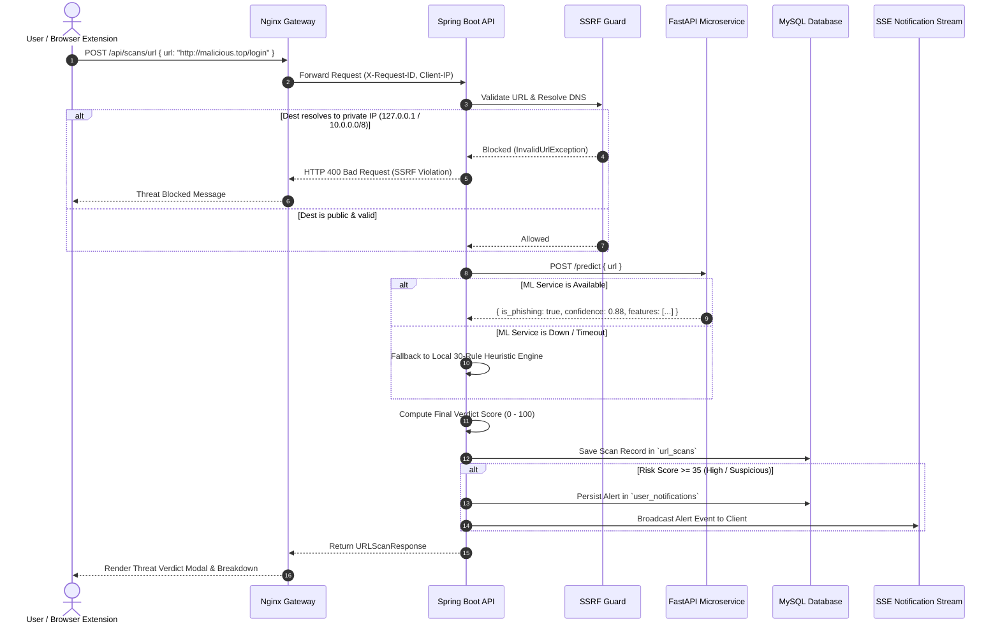

# Prahar 2.0 — System Architecture & Technical Specifications

## 1. High-Level System Architecture

Prahar employs a decoupled, multi-tier microservices architecture designed for resilience, fault tolerance, and defense-in-depth:

```text
                                  CLIENT TIER
         ┌─────────────────────────────────────────────────────────────┐
         │                                                             │
         │   React 18 SPA (Vite + Tailwind)    Chrome Extension (MV3)  │
         │   [Port 3000 / 5173]               [Browser Action Popup]   │
         │                                                             │
         └──────────────────────────────┬──────────────────────────────┘
                                        │ HTTPS (Port 443)
                                        │ Bearer JWT / X-Request-ID
                                        ▼
                                   EDGE TIER
         ┌─────────────────────────────────────────────────────────────┐
         │   Nginx 1.27 Reverse Proxy & TLS Gateway                    │
         │   - TLS 1.2 / 1.3 Termination                               │
         │   - Strict Server-Name Binding                              │
         │   - Rate Limiting Zones (API: 15r/s, Scans: 5r/s)           │
         │   - SSE Streaming Buffering Bypass                          │
         └──────────────────────────────┬──────────────────────────────┘
                                        │ Internal HTTP
                                        ▼
                              CORE APPLICATION TIER
         ┌─────────────────────────────────────────────────────────────┐
         │   Spring Boot 3.3.4 REST API Server [Port 8080]             │
         │                                                             │
         │   ┌─────────────────────┐       ┌───────────────────────┐   │
         │   │ Security Layer      │       │ Scanner Service       │   │
         │   │ - JWT Auth Filter   │       │ - Lexical Heuristics  │   │
         │   │ - RateLimitingFilter│       │ - SSRF Guard Engine   │   │
         │   │ - SensitiveScrubber │       │ - ZXing QR Engine     │   │
         │   └─────────────────────┘       │ - OCR Bridge Service  │   │
         │                                 └───────────────────────┘   │
         │   ┌─────────────────────┐       ┌───────────────────────┐   │
         │   │ Safety Centre       │       │ Notification Service  │   │
         │   │ - Dispute Generator │       │ - SSE Broadcaster     │   │
         │   │ - 1930 / Cybercrime │       │ - Idempotency Deduper │   │
         │   └─────────────────────┘       └───────────────────────┘   │
         └──────────────┬──────────────────────────────┬───────────────┘
                        │                              │
         Internal HTTP  │               TLS Encrypted  │
         (Private Net)  ▼               JDBC (Private) ▼
      ┌─────────────────────────┐           ┌─────────────────────────┐
      │ Python FastAPI ML [8000]│           │ MySQL 8.0 Database [3306]│
      │ - 30-Feature Extractor  │           │ - Row Binary Logging    │
      │ - XGBoost / Scikit-learn│           │ - Least-Privilege Users │
      │ - Governance Gates      │           │ - Point-In-Time Recovery│
      └─────────────────────────┘           └─────────────────────────┘
```

---

## 2. Core Subsystems & Technical Details

### A. Core Backend API (Spring Boot 3.3.4)
- **Role:** Central orchestrator for security, data storage, user authentication, and business workflows.
- **Port:** Internal TCP `8080` (Never exposed directly to the public internet in production).
- **Key Modules:**
  - `SsrfProtectionService`: Pre-validates all destination hostnames and IP addresses before issuing outbound lookups.
  - `ImageSecurityValidator`: Verifies magic byte signatures for uploaded files (PNG, JPEG, WebP, GIF, BMP) to prevent PHP/shell upload attacks.
  - `SensitiveDataScrubber`: Regex and Luhn-based sanitizer stripping credit cards, OTPs, and banking credentials before persistence.
  - `NotificationSseService`: Manages concurrent real-time Server-Sent Events emitters with 25-second keep-alive heartbeats.

### B. Machine Learning Microservice (FastAPI + Python 3.11)
- **Role:** High-speed feature extraction and probabilistic classification.
- **Port:** Internal TCP `8000` (Isolated inside `app-internal-network`).
- **Feature Extraction:** Extracts 30 structural, statistical, and lexical indicators per URL:
  - Length attributes: URL length, hostname length, path length, query length.
  - Character frequencies: Dot count, hyphen count, slash count, equal count, digit count.
  - Security flags: IP address in host, non-standard port, punycode, URL shortener domain.
  - Content entropy: Shannon entropy of the URL string.
- **Model Architecture:** Scikit-learn Logistic Regression / Random Forest and XGBoost classifiers serialized via Joblib.

### C. Persistent Storage Tier (MySQL 8.0)
- **Storage Engine:** InnoDB with `innodb_flush_log_at_trx_commit=1` for full ACID compliance.
- **Connection Security:** Enforces TLS (`sslMode=REQUIRED`, `useSSL=true`).
- **User Roles:**
  - `phishshield_app`: DML only (`SELECT, INSERT, UPDATE, DELETE`).
  - `phishshield_migrator`: DDL only (`CREATE, ALTER, INDEX`).

---

## 3. End-to-End Threat Detection Workflow



---

## 4. Fault Tolerance & Graceful Degradation Matrix

| Component Outage | Fallback Mechanism | Impact on User Experience |
| :--- | :--- | :--- |
| **FastAPI ML Service Offline** | Spring Boot automatically activates its built-in **30-Rule Heuristic Engine**. | URL scanning completes uninterrupted; response indicates heuristic mode. |
| **Google Gemini API Offline / No Key** | Spring Boot activates the local **22-Intent NLP Rule Engine**. | Conversational assistant answers Indian cyber safety queries locally. |
| **Tesseract OCR Binary Absent** | OCR service returns `ocrStatus: "UNEXTRACTED"` honestly. | QR codes are still decoded via ZXing; visual urgency rules run without crashing. |
| **MySQL Server Down (Dev Mode)** | Spring Boot starts with in-memory **H2 Database**. | Zero configuration required for development and academic demonstrations. |
